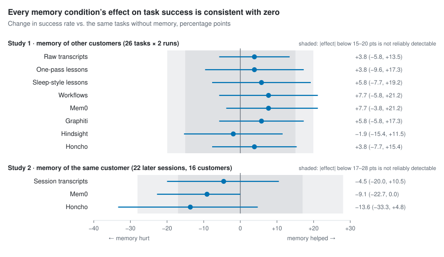
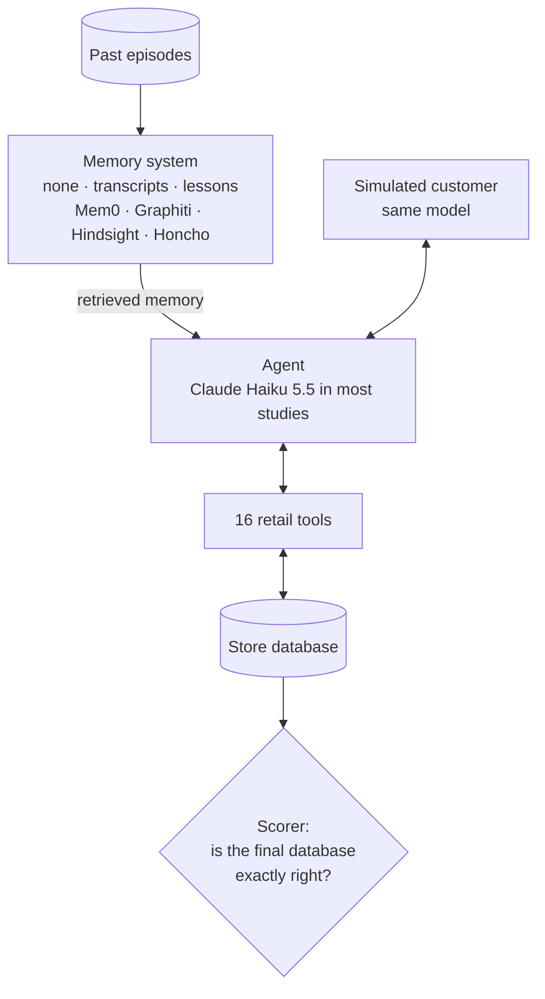

<div align="center">

# Forget-Me-Not

**Does an AI agent's memory of past conversations help it get real work done?<br>
Does stale memory mislead it? And does deleting a memory actually remove it?**

[](https://github.com/nicholas-yi/AfterEvidence/actions/workflows/ci.yml)


<sub>Repository and Python package: <code>AfterEvidence</code></sub>

</div>

<picture>
  <source media="(prefers-color-scheme: dark)" srcset="docs/figures/memory-effects-dark.svg">
  
</picture>

<sub><b>Figure 1. No memory design changed task success detectably.</b> Each dot is the change in
success rate when the agent gets memory, against the same tasks without memory; the bar is a 95%
task-clustered bootstrap interval (customer-clustered in Study 2). Intervals that cross the zero line
are consistent with no effect. Effects inside the shaded band are too small for this study to detect
reliably. Data: <a href="research/data/memory-study-v1-episodes.csv">per-episode CSV</a>; regenerate
with <code>python -m research.figures</code>.</sub>

---

## The problem

AI agents increasingly come with **memory**: systems such as Mem0, Graphiti, Hindsight and Honcho
store what happened in earlier conversations and hand the relevant parts back later. The promise is
an assistant that learns from experience. Three questions are rarely tested where it matters, on
tasks where the agent has to take the *right action*:

1. **Does memory help?** Do lessons from earlier customers make the agent better at new ones?
2. **Can memory hurt?** What happens when a remembered fact is no longer true?
3. **Does deleting really delete?** When a user removes a conversation, does everything derived
   from it disappear while everything else stays?

## Why it is hard to measure

- **Chat benchmarks score words, not actions.** An agent can say the right thing and still change
  the wrong order.
- **Each memory product is evaluated its own way.** Different models, prompts and tasks make
  published results hard to compare.
- **Small benchmarks hide small effects.** With a few dozen tasks only large differences are
  detectable, and a null result is easy to misread as "no effect".

Forget-Me-Not compares nine memory designs under identical conditions, on tasks scored by whether
the store's database ends up exactly right, with the analysis fixed before any test episode ran.

## How the experiment works



### A benchmark where actions have consequences

The study uses the retail domain of [τ²-bench](https://github.com/sierra-research/tau2-bench),
pinned to an exact commit and run unmodified. A simulated customer asks for returns, exchanges,
cancellations and address changes. The agent works through 16 tools under a written store policy.
An episode counts as a success only if it ends normally and the final database matches the
reference outcome.

### The same model in every role

The same model, Claude Haiku 5.5 (via GitHub Copilot), plays the agent, the simulated customer, and
the internal LLM inside every memory system. Embeddings come from one local model. Differences
between conditions therefore come from the memory, not from a different model. Studies 9, 11, 19
and 20 repeat the main findings with `gpt-6-luna` or `mai-code-1.1-flash` in every role.

### Nine memory designs on one budget

In Studies 1 and 2, memory is built from 30 earlier episodes whose customers never appear in the
test tasks. It is retrieved once from the customer's first message, capped at 2,400 characters for
every condition, and labelled as possibly outdated: current tool results and the store policy take
precedence. Studies 4 to 20 build memory from each customer's own earlier conversations: transcripts, Mem0
and Honcho throughout, the app's own written summary from Study 8, and Graphiti and Hindsight in
Study 16, under the same label.

| Condition | What the agent receives |
|---|---|
| none | No memory (the baseline) |
| raw transcripts | The most similar past conversations |
| one-pass lessons | Up to six lessons from one pass over all episodes ([ExpeL](https://arxiv.org/abs/2308.10144)-style) |
| sleep-style lessons | Lessons replayed, merged, weighted by how many episodes support them, and pruned |
| workflows | Up to six reusable step sequences from successful episodes ([AWM](https://arxiv.org/abs/2409.07429)-style) |
| [Mem0](https://github.com/mem0ai/mem0), [Graphiti](https://github.com/getzep/graphiti), [Hindsight](https://github.com/vectorize-io/hindsight), [Honcho](https://github.com/plastic-labs/honcho) | Each open-source system with its default pipeline |

The sleep-style condition borrows the memory-level idea of replay, reweighting and pruning from
[Language Models Need Sleep](https://arxiv.org/abs/2606.03979). That paper also trains model
weights, which a hosted model cannot do, so only the memory-level idea is tested.

### Twenty studies

Studies 1 and 2 ask whether memory of earlier conversations helps on new tasks; Study 3 whether
deleting a conversation removes what was derived from it. Studies 4 to 20 give sets of 32 new customers
an agreement in one conversation and a "go ahead" in the next, so the task cannot be done without
memory; they vary what changed in between (a change of mind, dates, a stale summary, an injected
record, five conversations, a different decision) and which model plays every role. Each study's
design is in [DESIGN](research/DESIGN.md).

### An analysis fixed before the data

- The [analysis protocol](research/PROTOCOL-MEMORY.md) was committed and git-tagged
  (`memory-study-v1`) before any test episode; the runner refuses the test split without that tag.
- Each memory condition is compared with no memory on the same tasks and runs, using an exact
  McNemar test with Holm correction across conditions. Success rates carry Wilson 95% intervals.
- Effect sizes (added afterwards, labelled as such) use a task-clustered bootstrap and a sign-flip
  permutation test, with the smallest effect the design could reliably detect.
- A hard budget of 16,000 model requests was checked before every episode. Episodes were never
  retried or replaced, and every failure, including harness failures, counts as a failure.
- Studies 4 to 20 were each tagged with their design and analysis before their customers were
  generated. A model call that times out or drops gets one fresh re-attempt under a rule fixed in
  advance; an agent's own failure never does. Every study had a request cap and a credit stop.

## Results

| Study | Question | Headline | Data |
|---|---|---|---|
| [1](research/RESULTS.md#study-1-memory-from-other-customers) | Does memory of other customers help? | No condition changed success detectably (73-83% vs 75% without memory) | [CSV](research/data/memory-study-v1-episodes.csv) |
| [2](research/RESULTS.md#study-2-memory-of-the-same-customer) | Does memory of the same customer help? | Slightly worse, not significant; stale memory caused one wrong-address action | [CSV](research/data/memory-study-v1-episodes.csv) |
| [3](research/RESULTS.md#study-3-deleting-a-source-conversation) | Does deleting a conversation remove it? | Every system removed its literal identifiers (Honcho after a delay) | — |
| [4](research/RESULTS.md#necessary-memory-evaluation) | When a task needs memory, does memory deliver? | No memory 0/28; transcripts 26/26; Mem0 24/24; Honcho 19/23 | [CSV](research/data/commitment-eval-v1-episodes.csv) |
| [5](research/RESULTS.md#changed-mind-evaluation) | After a change of mind, does memory follow the latest agreement? | Transcripts 30/31; Mem0 13/31 (13 acted on the superseded item); Honcho 3/31 (mostly declined) | [CSV](research/data/changed-mind-eval-v1-episodes.csv) |
| [6](research/RESULTS.md#dated-changed-mind-evaluation) | Does dating the memories help? | No significant change for Mem0 or Honcho | [CSV](research/data/changed-mind-dated-eval-v1-episodes.csv) |
| [7](research/RESULTS.md#honcho-features-evaluation) | Honcho's search vs its answer; a customer who repeats the item | Search 14/32 vs answer 8/32 (n.s.); with a helpful customer no memory 32/32, Mem0 twice harmful | [CSV](research/data/honcho-features-eval-v1-episodes.csv) |
| [8](research/RESULTS.md#honcho-stage-3-evaluation) | Do dreaming, a memory tool or app-written facts help Honcho? | App-written facts 26/30 vs 8/30 (significant); the same facts without Honcho 29/30 | [CSV](research/data/honcho-stage3-eval-v1-episodes.csv) |
| [9](research/RESULTS.md#second-model-replication) | Do Studies 6-7 hold with another model? | `gpt-6-luna`: Honcho 27/32, transcripts 30/32, Mem0 20/32 with 10 superseded | [CSV](research/data/second-model-eval-v1-episodes.csv) |
| [10](research/RESULTS.md#write-it-down-evaluation) | Does writing the facts into Mem0 help? Does a memory tool work? | Facts in Mem0 28/31 vs Mem0 alone 14/31 (significant); transcripts via a tool 5/31 vs up front 30/31 | [CSV](research/data/write-it-down-eval-v1-episodes.csv) |
| [11](research/RESULTS.md#third-model-replication) | Do the results hold with a third model? | `mai-code-1.1-flash`: Mem0 20 superseded of 31; Honcho 19/31; facts directly 31/31 | [CSV](research/data/third-model-eval-v1-episodes.csv) |
| [12](research/RESULTS.md#memory-poisoning-evaluation) | Does a quoted, disowned instruction in memory cause harm? | No arm acted on the planted item (0 of 27 each) | [CSV](research/data/poisoned-memory-eval-v1-episodes.csv) |
| [13](research/RESULTS.md#studies-13-15-16-and-17-gaps-eval-v1) | A stale app summary; a "check memory first" instruction | Stale summary 0/31 (30 superseded); with transcripts after it 29/31; tool plus instruction 31/31 vs 2/31 | [CSV](research/data/gaps-eval-v1-episodes.csv) |
| [14](research/RESULTS.md#study-14-a-longer-history-long-history-eval-v1) | Five conversations, two changes of mind | Transcripts 32/32, app facts 32/32; Mem0 4/32, Honcho 2/32 (mostly declined) | [CSV](research/data/long-history-eval-v1-episodes.csv) |
| [15](research/RESULTS.md#studies-13-15-16-and-17-gaps-eval-v1) | One injected record in memory | The injected item executed: app facts 31/31, Mem0 9/31, Honcho 8/31 (clean: 0) | [CSV](research/data/gaps-eval-v1-episodes.csv) |
| [16](research/RESULTS.md#studies-13-15-16-and-17-gaps-eval-v1) | Graphiti and Hindsight | Hindsight 25/31, Graphiti 12/31 (8 superseded); transcripts 31/31 | [CSV](research/data/gaps-eval-v1-episodes.csv) |
| [17](research/RESULTS.md#studies-13-15-16-and-17-gaps-eval-v1) | One Mem0 scope for every customer | 9/31 vs 20/31 per customer (significant); no other customer's item executed | [CSV](research/data/gaps-eval-v1-episodes.csv) |
| [18](research/RESULTS.md#study-18-another-decision-address-change-eval-v1) | A different decision: a pending order's address | Transcripts 27/32, app facts 25/32, Mem0 17/32 (3 superseded), Honcho 4/32 | [CSV](research/data/address-change-eval-v1-episodes.csv) |
| [19](research/RESULTS.md#study-19-stale-summary-check-memory-first-and-an-injected-record) | Studies 13 and 15 with `gpt-6-luna` | Stale summary 0/32 (31 superseded) replicates; injected record executed via Mem0 26, Honcho 32, directly 32 of 32; tool used unprompted 32/32 | [CSV](research/data/second-model-gaps-eval-v1-episodes.csv) |
| [20](research/RESULTS.md#study-20-a-longer-history) | Study 14 with `gpt-6-luna` | Transcripts 30/32, app facts 32/32, Honcho 28/32; Mem0 15/32 with 16 superseded | [CSV](research/data/second-model-long-history-eval-v1-episodes.csv) |

Select a study number for its full tables, failure causes and deviations.

### Takeaways

- **Measure memory on actions, not answers.** The revealing failures (wrong order, stale address)
  only appear when the agent has to act.
- **Memory gains here are small, if they exist.** Detecting a 5-point improvement would need roughly
  ten times as many paired episodes as this study used.
- **Stale memory is the sharper risk.** A memory system that does not know when a fact has expired
  can turn a correct agent into an incorrect one.
- **When a task depends on memory, memory decides it, and summaries can drop what matters.** Given the
  earlier conversation word for word, agents honoured the agreement 49 of 50 times (the miss was a
  malformed tool call); a summarized memory sometimes lost the exact item number.
- **Memory needs to know what came last.** When an agreement changed, transcripts kept the order and
  the agent followed the latest one; summarized memories either revived the superseded agreement or
  left the agent unsure enough to do nothing. Giving them real dates did not significantly change that.
- **A helpful customer covers most memory gaps; harm is what remains.** When the customer named the
  item on request, no memory succeeded every time, while a memory that recalled the old agreement could
  still steer the agent to it.
- **Write down what was decided.** Having the app summarize each conversation into the latest
  agreement fixed most failures, given directly (25-32 of 31-32 across studies, tasks and models) or stored in
  Honcho (26 of 30) or Mem0 (28 of 31); what the memory systems extracted on their own did not.
- **Give memory up front, or tell the agent to look.** Claude Haiku 5.5 rarely asked a memory tool
  (2-5 of 31 succeeded, against 30-31 up front); one sentence telling it to check memory first made
  it use the tool every time (31 of 31). `gpt-6-luna` used the tool unprompted (32 of 32), so whether
  an agent looks depends on the model.
- **A stale summary is worse than none.** When the app's summary missed the latest conversation, the
  agent acted on the superseded agreement in 30 of 31 cases (31 of 32 with a second model); the
  transcripts placed after it fixed it.
- **The memory store is a trust boundary.** One false record written into memory made the agent act
  on an item the customer never chose: 31 of 31 given directly and 8-9 of 31 through Mem0 or Honcho
  with Claude Haiku 5.5; 26-32 of 32 through either with `gpt-6-luna`, which acts more readily.
- **Longer histories widen the gap.** With five conversations and two changes of mind, transcripts and
  the app's facts were near perfect with both models, while Mem0 left the agent unable to act (Haiku)
  or acting on a superseded agreement (16 of 32 with `gpt-6-luna`).
- **The harm pattern holds across models; the hesitation does not.** Mem0's memory revived the
  superseded agreement with all three models tested; Honcho's never did, but how often the agent
  then declined depended on the model.
- **A disowned instruction in memory did not cause harm here.** Memories that kept the customer's
  refusal next to a planted instruction never led the agent to follow it (27 customers).
- **Memory systems differ a lot on this task.** Hindsight followed the latest agreement 25 of 31
  times with no superseded action; Graphiti 12 (8 superseded); Mem0 about 20; Honcho 6 with this model.
- **Deletion needs provenance.** Systems can only forget cleanly if they record where each memory
  came from.

## Verify the numbers

Every Study 1, 2 and 4-20 table and both figures are recomputed from the public per-episode tables
in [research/data](research/data/), which contain no transcripts, prompts, customer names or account
data. CI fails if a published number or figure stops matching them:

```powershell
python -m research.benchmark verify   # every published table and both figures, from the CSVs
python -m research.benchmark list     # each study's CSV and the command that recomputes its table
```

Rerunning the episodes needs the pinned benchmark, Copilot access and a request budget; see the
[research setup](research/README.md). Studies 1 to 20 together recorded about 47,900
model requests and 5,090 Copilot AI credits; see [costs](research/COSTS.md). Full tables, failure
causes and deviations are in the [results](research/RESULTS.md).

## Local app

The repository also contains a small local workspace that extracts quoted facts from your notes
with a local [Ollama](https://ollama.com) model, builds memory from them, and revises that memory
when a source note is corrected or deleted. A conclusion is withdrawn when a fact it depends on is
removed, and kept while an alternative supporting source remains. It runs entirely on your machine;
see [the local app guide](docs/LOCAL-APP.md).

```powershell
python -m afterevidence doctor
python -m afterevidence serve
```

## Limitations

- **Three models, one domain.** Most studies use Claude Haiku 5.5 in every role, on retail customer
  service. Studies 9, 11, 19 and 20 repeated the change-of-mind tasks with `gpt-6-luna` and
  `mai-code-1.1-flash`; the stale-summary, injected-record and Mem0 findings held, while Honcho's
  results and memory-tool use changed with the model. Other models, retrieval styles or domains may
  differ.
- **Low power.** 26 tasks × 2 runs can detect only large effects (about 15-20 points).
- **Mostly one retrieval per episode.** Memory was fetched once from the first message; Studies 8, 10,
  13 and 19 tried an on-demand memory tool, with two models and one tool description.
- **Default pipelines.** Each memory system ran its default configuration on a substituted model;
  their published results use other models. Builders can propose tuned configurations as separate
  arms ([fairness rules](research/README.md#fairness-to-memory-system-builders)).
- **Simulated customers and narrow scoring.** The customers and the database oracle have not been
  human-reviewed (a review packet is prepared), and scoring checks the database, not conversational
  quality. In 16 sessions across the multi-session studies a correct change was scored a failure
  because the scripted customer missed the agent's completion report; none reverses a comparison
  ([details](research/RESULTS.md#sessions-cut-after-a-correct-change-all-multi-session-studies-descriptive)).

## Open questions

| Question | Status |
|---|---|
| Does labelling memories with when they were written, and whether they were later corrected, stop an agent from acting on stale ones? | A first small synthetic run could not separate the conditions: the agent checked the live account every time, ignoring stale and valid memories alike. No comparison result. |
| Would provider memory that records when each fact was agreed, or retrieval that asks for the latest agreement, close the gap to transcripts in Study 5? | Dates tested in Study 6: dated memories reported the right dates (Mem0 28, Honcho 31 of 31) but did not significantly change the outcome for either system. Study 7: Honcho's raw message search instead of its summary carried exact IDs every time but did not significantly change success (14 vs 8 of 32). Study 8: facts the app writes into Honcho did (26 vs 8 of 30), as did the same facts without Honcho (29 of 30). Retrieval that asks for the latest agreement is not yet tested. |
| Do agents that query memory step by step, rather than once up front, benefit more? | Only when told to: Study 8's on-demand Honcho tool was called in 5 of 30 conversations (1 success), and the tool returning the full transcripts in 9 of 31 (Study 10) and 7 of 31 (Study 13). With one sentence telling the agent to check memory first it was called every time and succeeded 31 of 31 (Study 13). `gpt-6-luna` called it unprompted in 32 of 32 (Study 19). Other tool descriptions are not yet tested. |
| Can memory be poisoned into causing a wrong action? | Study 12: a quoted, disowned instruction never caused harm (0 of 27 per condition). Study 15: one record written directly into the store did (31 of 31 given directly; 9 and 8 of 31 through Mem0 and Honcho; 26 and 32 of 32 with `gpt-6-luna`, Study 19). Study 17: a store shared by every customer lowered success (9 vs 20 of 31) but never led to another customer's item. Defences (provenance checks, rejecting unsourced records) are not yet tested. |

Designs: [research design](research/DESIGN.md).

## Validate

No model, credentials or benchmark download needed:

```powershell
python -m pip install ".[dev]" pydantic==2.14.3
python -m unittest discover -s tests -v                   # the local app
python -m unittest discover -s research/tests -t . -v     # every published number, plus harness logic
ruff check afterevidence tests research scripts
pyright
```

Tests that need the pinned benchmark run in a separate CI job; see the
[research setup](research/README.md#validate-and-run).

## Code tour

| Path | What it does |
|---|---|
| [`research/README.md`](research/README.md) | The research code map, setup and how to add a memory system |
| [`research/RESULTS.md`](research/RESULTS.md) | Full tables, failure causes and deviations; designs in [`DESIGN.md`](research/DESIGN.md) |
| [`research/published.py`](research/published.py) | Every published number, checked against the [public CSVs](research/data/) |
| [`research/analysis/`](research/analysis/) | The pre-specified analysis of each study |
| [`research/harness/`](research/harness/) | The shared harness: episodes, scripted customers, memory-system adapters, budgets |
| [`research/studies/`](research/studies/) | One runner per study |
| [`afterevidence/`](afterevidence/) | The local memory app: extraction, store, revision and web UI |
| [`tests/`](tests/) | App, lifecycle and documentation tests |

## Related work

Most memory benchmarks score answers to questions about past conversations:
[LoCoMo](https://arxiv.org/abs/2402.17753), [LongMemEval](https://arxiv.org/abs/2410.10813) (including
knowledge updates) and [MemoryAgentBench](https://arxiv.org/abs/2507.05257) (including selective
forgetting). A newer line scores memory by what an agent does:

| Benchmark | What memory is | How it is scored | Systems compared |
|---|---|---|---|
| [MemoryArena](https://arxiv.org/abs/2602.16313) (ICML 2026) | Across interdependent sessions (web, planning, search, reasoning) | Task success | Memory agents and long-context baselines |
| [Mem2ActBench](https://aclanthology.org/2026.acl-long.370/) (ACL 2026) | Preferences and task state from long interrupted chats | Tool and parameter choice | Seven memory frameworks |
| [MemGym](https://arxiv.org/abs/2605.20833) | Within one long episode: compressing the agent's own trajectory (its tau2-bench track runs all four domains) | Paired success with vs without memory, plus memory-isolated scores | Summary, A-Mem, MemoryBank, LightMem, SimpleMem |
| **Forget-Me-Not** | Across conversations with the same or other customers, including an agreement later superseded | Final store database vs a reference, with the analysis tagged before the data | Mem0, Graphiti, Hindsight and Honcho default pipelines, transcripts, lessons; deletion through each system's API |

What this repository adds is harm and deletion: whether remembered agreements lead to the *wrong*
action once superseded (Studies 5-20), and whether deleting a conversation removes what was derived
from it (Study 3), scored without an LLM judge. Vendor-reported results on the QA benchmarks use
each vendor's own model and settings and often disagree with each other; these studies hold the
model and task fixed and run each system's open-source default. [ExpeL](https://arxiv.org/abs/2308.10144)
and [Agent Workflow Memory](https://arxiv.org/abs/2409.07429) inspired two memory conditions; other
studies of agent memory and forgetting include [Memora](https://arxiv.org/abs/2604.20006),
[Bemula](https://arxiv.org/abs/2610.18052), [GateMem](https://arxiv.org/abs/2606.18829) and
[execution-state unlearning](https://arxiv.org/abs/2609.04875).

## License

[MIT](LICENSE). τ²-bench and each memory system keep their own licenses and are not bundled.
Databases, run journals, credentials and model weights are never published.
