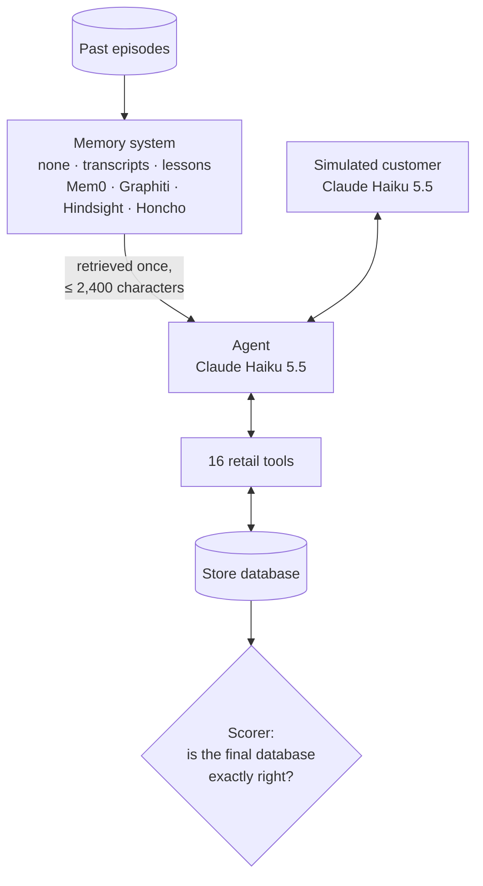

<div align="center">

# Forget-Me-Not

**Does an AI agent's memory of past conversations help it get real work done?<br>
Does stale memory mislead it? And does deleting a memory actually remove it?**

[](https://github.com/nicholas-yi/AfterEvidence/actions/workflows/ci.yml)


<sub>Repository and Python package: <code>AfterEvidence</code></sub>

</div>

<picture>
  <source media="(prefers-color-scheme: dark)" srcset="docs/figures/memory-effects-dark.svg">
  
</picture>

<sub><b>Figure 1. No memory design changed task success detectably.</b> Each dot is the change in
success rate when the agent gets memory, against the same tasks without memory; the bar is a 95%
task-clustered bootstrap interval (customer-clustered in Study 2). Intervals that cross the zero line
are consistent with no effect. Effects inside the shaded band are too small for this study to detect
reliably. Data: <a href="research/data/memory-study-v1-episodes.csv">per-episode CSV</a>; regenerate
with <code>python -m research.figures</code>.</sub>

---

## The problem

AI agents increasingly come with **memory**: systems such as Mem0, Graphiti, Hindsight and Honcho
store what happened in earlier conversations and hand the relevant parts back later. The promise is
an assistant that learns from experience. Three questions are rarely tested where it matters, on
tasks where the agent has to take the *right action*:

1. **Does memory help?** Do lessons from earlier customers make the agent better at new ones?
2. **Can memory hurt?** What happens when a remembered fact is no longer true?
3. **Does deleting really delete?** When a user removes a conversation, does everything derived
   from it disappear while everything else stays?

## Why it is hard to measure

- **Chat benchmarks score words, not actions.** An agent can say the right thing and still change
  the wrong order.
- **Each memory product is evaluated its own way.** Different models, prompts and tasks make
  published results hard to compare.
- **Small benchmarks hide small effects.** With a few dozen tasks only large differences are
  detectable, and a null result is easy to misread as "no effect".

Forget-Me-Not compares nine memory designs under identical conditions, on tasks scored by whether
the store's database ends up exactly right, with the analysis fixed before any test episode ran.

## How the experiment works



### A benchmark where actions have consequences

The study uses the retail domain of [τ²-bench](https://github.com/sierra-research/tau2-bench),
pinned to an exact commit and run unmodified. A simulated customer asks for returns, exchanges,
cancellations and address changes. The agent works through 16 tools under a written store policy.
An episode counts as a success only if it ends normally and the final database matches the
reference outcome.

### The same model in every role

The same model, Claude Haiku 5.5 (via GitHub Copilot), plays the agent, the simulated customer, and
the internal LLM inside every memory system. Embeddings come from one local model. Differences
between conditions therefore come from the memory, not from a different model.

### Nine memory designs on one budget

Memory is built from 30 earlier episodes whose customers never appear in the test tasks. It is
retrieved once from the customer's first message, capped at 2,400 characters for every condition,
and labelled as possibly outdated: current tool results and the store policy take precedence.

| Condition | What the agent receives |
|---|---|
| none | No memory (the baseline) |
| raw transcripts | The most similar past conversations |
| one-pass lessons | Up to six lessons from one pass over all episodes ([ExpeL](https://arxiv.org/abs/2308.10144)-style) |
| sleep-style lessons | Lessons replayed, merged, weighted by how many episodes support them, and pruned |
| workflows | Up to six reusable step sequences from successful episodes ([AWM](https://arxiv.org/abs/2409.07429)-style) |
| [Mem0](https://github.com/mem0ai/mem0), [Graphiti](https://github.com/getzep/graphiti), [Hindsight](https://github.com/vectorize-io/hindsight), [Honcho](https://github.com/plastic-labs/honcho) | Each open-source system with its default pipeline |

The sleep-style condition borrows the memory-level idea of replay, reweighting and pruning from
[Language Models Need Sleep](https://arxiv.org/abs/2606.03979). That paper also trains model
weights, which a hosted model cannot do, so only the memory-level idea is tested.

### Three studies

| Study | Question | Design |
|---|---|---|
| **1. Other customers** | Does memory of earlier, different customers help on new tasks? | 9 conditions × 26 test tasks × 2 runs = 468 episodes |
| **2. Same customer** | Does memory of a customer's earlier sessions help their later ones? | 16 customers, 22 later sessions × 4 conditions; the database resets between sessions, so remembered facts can be stale |
| **3. Deletion** | After deleting one conversation, is everything derived from it gone, and is everything else intact? | 3 conversations per system; delete one through the system's own API, then probe |

### An analysis fixed before the data

- The [analysis protocol](research/PROTOCOL-MEMORY.md) was committed and git-tagged
  (`memory-study-v1`) before any test episode; the runner refuses the test split without that tag.
- Each memory condition is compared with no memory on the same tasks and runs, using an exact
  McNemar test with Holm correction across conditions. Success rates carry Wilson 95% intervals.
- Effect sizes (added afterwards, labelled as such) use a task-clustered bootstrap and a sign-flip
  permutation test, with the smallest effect the design could reliably detect.
- A hard budget of 16,000 model requests was checked before every episode. Episodes were never
  retried or replaced, and every failure, including harness failures, counts as a failure.

## Results

### Study 1: memory from other customers

<picture>
  <source media="(prefers-color-scheme: dark)" srcset="docs/figures/study1-success-cost-dark.svg">
  
</picture>

<sub><b>Figure 2. Success and cost were similar across conditions.</b> Left: success rate with its
Wilson 95% interval and successes out of 52 paired episodes; the dashed line is the no-memory rate.
Right: recorded AI credits per episode for the agent and customer, plus (orange) model calls the
memory system made at retrieval; building the memory is excluded. Data:
<a href="research/data/memory-study-v1-episodes.csv">per-episode CSV</a>.</sub>

| Condition | Success | Change vs. no memory (95% CI) |
|---|---:|---:|
| none | 39 / 52 (75%) | — |
| raw transcripts | 41 / 52 (79%) | +3.8 pts (−5.8, +13.5) |
| one-pass lessons | 41 / 52 (79%) | +3.8 pts (−9.6, +17.3) |
| sleep-style lessons | 42 / 52 (81%) | +5.8 pts (−7.7, +19.2) |
| workflows | 43 / 52 (83%) | +7.7 pts (−5.8, +21.2) |
| Mem0 | 43 / 52 (83%) | +7.7 pts (−3.8, +21.2) |
| Graphiti | 42 / 52 (81%) | +5.8 pts (−5.8, +17.3) |
| Hindsight | 38 / 52 (73%) | −1.9 pts (−15.4, +11.5) |
| Honcho | 41 / 52 (79%) | +3.8 pts (−7.7, +15.4) |

**No memory design changed task success detectably** (every Holm-corrected p = 1.0). The design could
reliably detect only differences of about 15-20 points, so this is *not* evidence that memory is
useless, only that any benefit here is smaller than that.

- The sleep-style process kept 4 of 89 candidate lessons and produced the shortest memory
  (1,555 characters), with no detectable difference from simpler one-pass lessons.
- Memory from Mem0, Graphiti, Hindsight and raw transcripts carried other customers' order numbers
  (1.6-7.2 per episode), but no agent ever used another customer's identifier in a tool call.

### Study 2: memory of the same customer

| Condition | Success on later sessions | Change vs. no memory (95% CI) |
|---|---:|---:|
| none | 20 / 22 (91%) | — |
| session transcripts | 19 / 22 (86%) | −4.5 pts (−20.0, +10.5) |
| Mem0 | 18 / 22 (82%) | −9.1 pts (−22.7, 0.0) |
| Honcho | 17 / 22 (77%) | −13.6 pts (−33.3, +4.8) |

Without memory the agent already succeeded on 91% of later sessions, leaving little room to improve.
Memory was, if anything, slightly worse, but no difference is significant, and with only a few
customers differing these intervals are rough. Two of Honcho's five failures were malformed actions
in the first three requests rather than anything its memory said. The clearest failure came from
**stale memory**:

> A customer had changed her address in an earlier session, but the database had since been reset.
> Mem0 and Honcho both "remembered" that the change was done and the old address was gone. Both
> agents acted on that memory and changed the address on the wrong order. The agent without memory
> checked the account and got it right.

This is a single task (n = 1), so it illustrates a failure mode rather than measuring its frequency.

### Study 3: deleting a conversation

| System | Deleted conversation's identifiers after delete | Other memories kept |
|---|---|---:|
| Mem0 | removed | 100% |
| Graphiti | removed | 100% |
| Hindsight | removed | 100% |
| Honcho | still visible immediately; removed on a recheck minutes later | 100% |
| sleep-style lessons | 4 of 4 lessons kept, with reduced support counts | — |
| one-pass lessons | 0 of 6 lessons kept (each cited every source) | — |

Every system eventually removed the deleted conversation's literal identifiers. The probe checks
exact identifiers only, not paraphrased or derived facts, so it shows deletion working at the
surface, not that the information is fully erased. Lessons that track how many episodes support
them degrade gracefully when one source is withdrawn; lessons that depend on every source collapse.

### Takeaways

- **Measure memory on actions, not answers.** The revealing failures (wrong order, stale address)
  only appear when the agent has to act.
- **Memory gains here are small, if they exist.** Detecting a 5-point improvement would need roughly
  ten times as many paired episodes as this study used.
- **Stale memory is the sharper risk.** A memory system that does not know when a fact has expired
  can turn a correct agent into an incorrect one.
- **Deletion needs provenance.** Systems can only forget cleanly if they record where each memory
  came from.

## Verify the numbers

Every Study 1 and Study 2 table and both figures are recomputed from a public per-episode table,
[memory-study-v1-episodes.csv](research/data/memory-study-v1-episodes.csv), which contains no
transcripts, prompts, customer names or account data. CI fails if a published number or figure
stops matching it:

```powershell
python -m research.memory_analysis --csv research/data/memory-study-v1-episodes.csv
python -m research.figures --check
python -m unittest research.test_memory_csv -v
```

Rerunning the episodes needs the pinned benchmark, Copilot access and a request budget; see the
[research setup](research/README.md). The study started 12,428 model requests and recorded 1,425
Copilot AI credits (about $14.25 of allowance); see [costs](research/COSTS.md). Full tables, failure
causes and deviations are in the [results](research/RESULTS.md).

## Local app

The repository also contains a small local workspace that extracts quoted facts from your notes
with a local [Ollama](https://ollama.com) model, builds memory from them, and revises that memory
when a source note is corrected or deleted. A conclusion is withdrawn when a fact it depends on is
removed, and kept while an alternative supporting source remains. It runs entirely on your machine;
see [the local app guide](docs/LOCAL-APP.md).

```powershell
python -m afterevidence doctor
python -m afterevidence serve
```

## Limitations

- **One model, one domain.** Every role uses the same model on retail customer service; results may
  differ for other models, retrieval styles or domains.
- **Low power.** 26 tasks × 2 runs can detect only large effects (about 15-20 points).
- **One retrieval per episode.** Memory was fetched once from the first message; agents that query
  memory step by step were not tested.
- **Default pipelines.** Each memory system ran its default configuration on a substituted model;
  their published results use other models.
- **Simulated customers and narrow scoring.** The customer is an LLM whose fidelity has not been
  human-reviewed, and scoring checks the database, not conversational quality.

## Open questions

| Question | Status |
|---|---|
| Does labelling memories with when they were written, and whether they were later corrected, stop an agent from acting on stale ones? | A first small synthetic run could not separate the conditions: the agent checked the live account every time, ignoring stale and valid memories alike. No comparison result. |
| When a task cannot be done without remembering an earlier agreement, does memory of that conversation let the agent finish it, and does a cautionary memory header hold it back? | Designed and implemented; no memory comparison has run yet. |
| Do agents that query memory step by step, rather than once up front, benefit more? | Not yet tested. |

Designs: [research design](research/DESIGN.md).

## Validate

No model, credentials or benchmark download needed:

```powershell
python -m pip install ".[dev]"
python -m unittest discover -s tests -v
python -m unittest research.test_memory_methods research.test_costing research.test_memory_csv -v
ruff check afterevidence tests research scripts
pyright
```

## Code tour

| Path | What it does |
|---|---|
| [`research/PROTOCOL-MEMORY.md`](research/PROTOCOL-MEMORY.md) | The analysis protocol, git-tagged `memory-study-v1` before any test episode |
| [`research/RESULTS.md`](research/RESULTS.md) | Full tables, failure causes and deviations |
| [`research/memory_bank.py`](research/memory_bank.py) | Builds the in-house memories: transcripts, lessons, sleep-style lessons, workflows |
| [`research/memory_gateway.py`](research/memory_gateway.py) | Adapters for Mem0, Graphiti, Hindsight and Honcho |
| [`research/tau_copilot.py`](research/tau_copilot.py) | Runs one τ²-bench episode with the agent, simulated customer and memory |
| [`research/memory_analysis.py`](research/memory_analysis.py) | Statistics, including recomputation from the public CSV |
| [`research/figures.py`](research/figures.py) | Draws the README figures from the public CSV |
| [`research/data/`](research/data/memory-study-v1-episodes.csv) | The public per-episode table |
| [`afterevidence/`](afterevidence/) | The local memory app: extraction, store, revision and web UI |
| [`tests/`](tests/) | App, lifecycle and documentation tests |

## Related work

[ExpeL](https://arxiv.org/abs/2308.10144) and [Agent Workflow Memory](https://arxiv.org/abs/2409.07429)
inspired two of the memory conditions. Related studies of agent memory and forgetting include
[Memora](https://arxiv.org/abs/2604.20006), [Bemula](https://arxiv.org/abs/2610.18052),
[GateMem](https://arxiv.org/abs/2606.18829) and
[execution-state unlearning](https://arxiv.org/abs/2609.04875).

## License

[MIT](LICENSE). τ²-bench and each memory system keep their own licenses and are not bundled.
Databases, run journals, credentials and model weights are never published.
