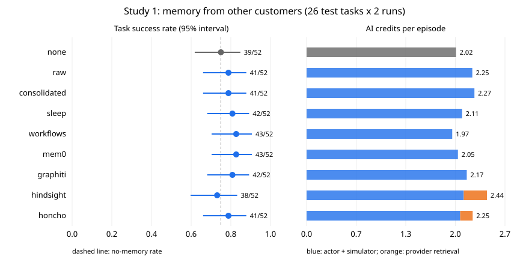

# Does agent memory help when the agent has to act? Nine approaches, one null result

*Draft. Numbers come from [the memory study](../research/RESULTS.md#memory-study-v1);
the protocol was [committed and tagged](../research/PROTOCOL-MEMORY.md) before
any test episode ran.*

## TL;DR

- On a customer-service benchmark scored by the store's database state, nine
  memory setups produced **no detectable change in task success**: 75% with no
  memory, 73-83% with memory, and every corrected p-value was 1.0.
- That includes Mem0, Graphiti, Hindsight, Honcho, induced workflows, and a
  memory-level take on Google's "sleep" consolidation.
- When the same customer came back, memory of their earlier sessions did
  slightly *worse* than none. The clearest failure came from facts that had
  stopped being true.
- All four memory products cleanly forgot a deleted conversation. Honcho
  needed a few minutes before the deletion showed up.

## The setup

[tau2-bench](https://github.com/sierra-research/tau2-bench) retail gives an
agent real tools (look up orders, exchange items, cancel, change addresses) and
a simulated customer. An episode succeeds only if the database ends up exactly
right, so memory has to change actions, not just answers.

- One model everywhere: Claude Haiku 5.5 (via GitHub Copilot) as agent,
  simulated customer, and each memory system's internal LLM. Embeddings were
  local (`nomic-embed-text`).
- Memory came from 30 earlier conversations with customers who never appear
  in the test set. It was retrieved once from the customer's opening message,
  capped at 2,400 characters, and labeled as possibly outdated.
- 26 test tasks that can be scored without an LLM judge, two runs each, paired
  against the same task without memory.

## Result 1: memory from other customers did not move success

| Memory | Success | Credits / episode |
|---|---:|---:|
| None | 39/52 | 2.03 |
| Raw transcripts | 41/52 | 2.25 |
| One-pass lessons | 41/52 | 2.27 |
| Sleep-style lessons | 42/52 | 2.11 |
| Induced workflows | 43/52 | 1.97 |
| Mem0 | 43/52 | 2.05 |
| Graphiti | 42/52 | 2.17 |
| Hindsight | 38/52 | 2.44 |
| Honcho | 41/52 | 2.25 |

The baseline agent was already given the store policy, so most of what memory
could teach ("verify identity first", "exchanges need delivered orders") was
already in context. The failures that remained were reasoning slips, which
other customers' memories do not fix.

### What about "sleep"?

Google's [Language Models Need Sleep](https://arxiv.org/abs/2606.03979)
consolidates experience into model weights. That cannot run on a hosted model,
so the study tested the memory-level idea instead: replay each episode, merge
similar lessons, weight each by how many episodes support it, and prune the
weak ones. 89 candidate lessons became 4. Success was 42/52, statistically
indistinguishable from everything else. What the support counts did buy was
graceful deletion: removing a source episode left all 4 lessons standing with
less support, while one-pass lessons that cite every source had to be dropped.

## Result 2: remembering the same customer can backfire

16 customers had several tasks each. Every later session ran with and without
memory of that customer's earlier sessions. The benchmark resets the database
between sessions, so a remembered change might no longer hold.

| Memory | Success on 22 later sessions |
|---|---:|
| None | 20 |
| Session transcripts | 19 |
| Mem0 | 18 |
| Honcho | 17 |

None of these differences is significant. The clearest loss is instructive:
Mem0 and Honcho both recalled that a customer's address change was done and her
old address was "no longer on file". In the current database it was still on
file, and both agents changed the wrong order. The agent without memory got it
right. **Memory that cannot tell when it is stale is a liability for an agent
that acts.**

## Result 3: deletion works

Each provider stored three conversations; one was deleted through the
provider's own API. Mem0, Graphiti, and Hindsight immediately removed every
identifier from the deleted conversation and kept all others. Honcho still
showed one identifier right after deletion and none a few minutes later.

## Caveats

One model, one domain, judge-free tasks, two runs per task: only large effects
were detectable. Providers ran their default pipelines on a substituted model.
Retrieval was a single shot, not an agent deciding when to recall. These
results say "no large effect here", not "memory never helps".

## What I would try next

- **Staleness-aware memory:** store when and from what each fact came, and
  have the agent check current tool results before acting on it. Honcho's
  reasoning-over-memory design is a natural place to test this.
- **Harder tasks or a weaker base agent**, where a no-memory agent has more
  room to fail.
- **Agentic retrieval** instead of one up-front lookup.

## Reproduce it

Everything is in [AfterEvidence](https://github.com/nicholas-yi/AfterEvidence):
the [protocol](../research/PROTOCOL-MEMORY.md), [runbook](../research/MEMORY-STUDY.md),
provider gateway, and analysis. The whole study used 12,428 model requests,
about 1,425 Copilot AI credits.
