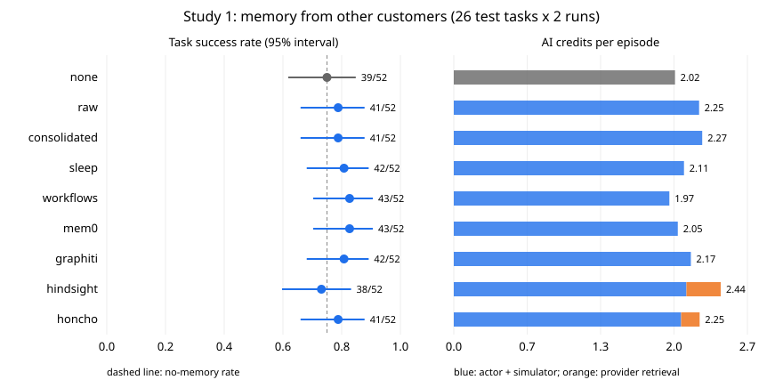
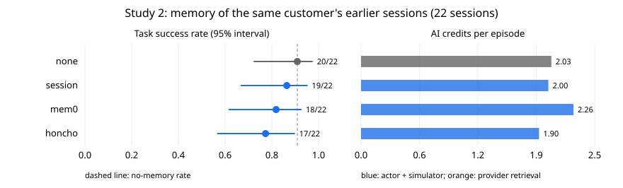

# Research feasibility and metering results

## What this report is

A real-task feasibility, cost, and memory-comparison report. The early sections
are development feasibility work. The [memory study](#memory-study-v1) ran
under a protocol committed and tagged before its test-split episodes. It is an
exploratory single-model study, not a leaderboard submission or paper result.

The original UI was not extended for this work. The research used the
unmodified native retail environment and tools from MIT-licensed tau2-bench
at `c06b07dd7c4d4ec61ba6ff9bcdf0b15dd7ef36d4`.

## Initial feasibility trials

| Trial | Actual model requests | Outcome | Duration |
|---|---:|---|---:|
| Native local Qwen development task 0 | 12 | Terminated normally; native ENV reward **0** | 400.968 s |
| Copilot access/metering micro-pilot | 3 | Completed; **not a whole task or scored episode** | 11.750 s |
| Copilot full-task attempt, prose output | 2 | Rejected because actor output violated the JSON-action contract | 10.813 s |
| Structured-action retry within the remaining budget | 18 | Executed real tools; stopped at the explicit request cap before termination | 108.312 s |

Failed setup attempts were preserved. Model-unavailable, incompatible-version,
relative-directory, and invalid-limit failures occurred before sending a model
prompt. No credential was extracted from VS Code or pasted into source.

### Why the native baseline is not yet a useful main-study baseline

The local model did not achieve the native database goal on the first complex
development task. The Copilot actor was capable of querying the native tools
and executing an actual exchange, but its conversation was not completed
within the authorized cap.

An additional **zero-inference** native replay used the actual recorded
messages and final assistant reply:

- 25 observed messages replayed.
- All five reference actions validated without a suppressed reference failure.
- The reference changed the database, so this was not a trivial no-action match.
- The observed partial database **did not match** the native target.
- No terminal user message was invented, no model was called, and no complete
  official pass was inferred.

The observed dialogue raises interpretation/user-simulator-fidelity questions
around requested compatibility and which items the user ultimately agreed
to exchange. That is a diagnostic lead, **not proof that the benchmark is
incorrect or that memory would fix the failure**.

### What was repaired in the adapter

Prompting alone did not enforce JSON. The adapter now uses the SDK's supported
structured-response contract, validates the resulting message/tool choice,
validates arguments against the native tool schema, and lets only the native
orchestrator execute the tool.

Timeouts explicitly abort the SDK generation. A stopped waiter is not treated
as proof that generation stopped. Incomplete/capped runs now produce a
nonzero CLI exit status and preserve partial observed messages.

## Initial measured usage

All 23 completed Copilot requests were through the existing authenticated
Copilot allowance, using account-enabled Claude Haiku 5.5:

- Input: **184,686 tokens**.
- Output: **9,947 tokens**.
- Recorded usage: **2.4402365 AI credits**.
- Dollar-equivalent credit value: **$0.024402365** at the published conversion.
- No separately billed OpenAI/Anthropic API was used.

The SDK returned complete billing status. Root session totals were summed
once; nested model/provider/event copies were not counted again.

Before/after account quota snapshots and overage settings remain in the
private local journals. An unchanged rounded quota display is not proof of
free usage, and legacy request counters are not automatically AI-credit
balances or an exact monthly-call allowance.

See [cost assumptions and planning estimates](COSTS.md).

## Bounded baseline follow-up: 2026-11-13

The next allowance covered at most **90 requests**, at most 30 per selected
development task, including both the actor and simulated customer. The fixed
cohort was official training tasks **0, 1, 2**. A local pre-run record captured
the source hashes, caps, seed, and scorer controls before new inference.
It is a development record, **not main-study preregistration**.

### Zero-inference scorer controls

The [native scoring adapter](native_scoring.py) now checks the reference
trajectory before initializing Copilot. For tasks 0 and 1:

- Every reference action executed without a suppressed reference exception.
- Native reference ENV reward was 1.0.
- The reference changed the database.
- An empty trajectory did not match that target.

Task 2 failed the strict preflight: reference action 2, `get_product_details`,
raised **"Product not found"** for the referenced product. It received **zero
model calls** and was not silently replaced by an easier task. This is a
conservative reference-replay exclusion, not proof that its final database
goal is undefined or that the whole benchmark is incorrect. The upstream ENV
evaluator logs reference exceptions and continues; this pilot does not accept
that as a fully validated reference.

### All inference attempts, including repairs

| Task / adapter | Requests | Duration | Outcome | AI credits |
|---|---:|---:|---|---:|
| 0 / original flat action | 14 | 93.125 s | Rejected a message carrying a placeholder tool name; no episode score | 1.546155 |
| 1 / nested message-or-tool action | 4 | 16.000 s | Rejected an empty message; no episode score | 0.208421 |
| 1 / shared nonempty-value action | 17 | 102.422 s | Normal `USER_STOP`; native ENV **1.0**, native task-basis **1.0** | 1.8368675 |
| 2 | 0 | Not run | Strict reference preflight failed | 0 |

Both schema failures remain in their original journals. Repairs were recorded
before the next attempt; no invalid action was silently stripped or executed.
Task 1's failed four requests count toward its 30-request cap: its total was
**21**, not 17. Task 0 was not retried. Different adapter versions were used,
so these attempts must not be pooled as an efficacy estimate.

The live schema now uses one nonempty `value` for either customer-facing text
or a tool name, plus JSON-encoded arguments. It has no irrelevant empty name
field or nested union. Native tool-name/argument validation remains in place.
Historical schemas remain readable for replay, not live inference.

### What the completed episode establishes

The actor verified the customer, consulted native account/order/product tools,
obtained confirmation, and executed the thermostat-only exchange required by
task 1's fallback instruction. The keyboard remained unchanged. The simulated
customer ended with the native stop marker.

A fresh, zero-inference replay of the saved episode reproduced both rewards
and the assessment. Task 1's reward basis contains DB and NL_ASSERTION, but its
NL assertion list is empty; **no LLM judge was called**. The task-basis score
therefore does not certify general policy compliance. Its communication list
is also empty, so a communication reward of 1 is not an independent quality test.
This is a custom actor adapter, not an official leaderboard submission.

The general scoring path leaves nonempty required NL assertions explicitly
unassessed rather than invoking an unapproved provider or declaring a full
reward. Premature termination is reported as incomplete, with a failing CLI
exit, rather than a completed episode.

### What remains unresolved

- There is only **one completed new episode**, not a useful accuracy estimate.
- Tasks 0 and 1 are sibling variants for the same customer and order, not
  independent samples or a valid train/evaluation separation. The later
  [offline audit](#offline-task-audit-2026-11-13-devbox) found that tasks 0-4,
  including task 2, all belong to that one customer.
- The task-1 simulator accepted a Google Assistant variant for a request
  phrased as Google Home; task-0 dialogue challenged that mapping. The
  [later analysis](#google-home-versus-google-assistant-tasks-0-and-1) found
  the catalog has no Google Home option and the reference uses the Google
  Assistant variant. A matching database alone does not establish simulator fidelity.
- Task 2 needs reference-artifact review before model spend or inclusion;
  the offline audit traced it to a copied docstring placeholder ID.
- No experience bank, four-condition result, or main-study preregistration
  was produced by this follow-up.

### Follow-up usage and preserved evidence

All **35 new requests** have complete billing evidence:

- Input: **279,026 tokens**; output: **14,633 tokens**.
- Consumption: **3.5914435 AI credits**, about **$0.035914435 in credit value**.
- **55 of the 90 authorized requests were unused**; they were not reallocated
  to unapproved tasks or used to chase a passing result.
- Including the initial pilots: **58 requests**, **463,712 input** and
  **24,580 output tokens**, **6.03168 AI credits** ($0.0603168 in credit value).

These are allowance measurements, not separate API invoices. Private local
evidence remains under `runs/`: `baseline-20261113-plan.json`, the two
`baseline-20261113-amendment-*.json` records, all three task journals/reports,
and `baseline-20261113-summary.json`. Do not publish raw journals, quota
snapshots, or account data.

## Offline task audit: 2026-11-13 (devbox)

Zero model calls. [task_audit.py](task_audit.py) reads the pinned retail
`tasks.json`, `split_tasks.json`, `db.json`, and tool source as plain JSON/text.
It derives each task's customers and orders from its reference actions, joins
train tasks that share a customer or order into families, and flags reference
IDs or customer lookups that the initial database cannot satisfy. It is a static
audit, **not** a simulator check or difficulty estimate. Its output is derived
from hidden reference actions and must never reach an actor, simulator, or memory.

```powershell
python -m research.task_audit
python -m research.task_audit --rows
```

### Native preflight on the whole train split

The pinned environment then ran zero-inference
`research.native_scoring` on all 74 train tasks: **64 validated, 10 failed**
(2, 3, 4, 35, 37, 46, 47, 54, 67, 105). Tasks 0 and 1 validated and task 2
failed exactly as on the laptop.

The static audit predicted 9 of the 10 failures and none of the validated
tasks. The miss, task 105, fails on a business rule ("Insufficient gift card
balance to pay for the price difference"), which a static ID check cannot see.
Five validated references (10, 24, 25, 50, 57) do not change the database,
matching the static no-write flag.

### Task 2 reference mismatch

- Failing action: `2_1`, the second reference action (native preflight numbers
  from 1), `get_product_details(product_id="6086499569")`.
- `6086499569` is neither a product ID nor an item ID in the pinned database.
  It is the example ID in the pinned `get_product_details` docstring
  ("The product id, such as '6086499569'"), so the reference appears to have
  copied a placeholder. The task's user instructions never mention it.
- The same action appears as action 2 of train tasks **2, 3, and 4**. These are
  the only flagged references across all 114 retail tasks whose bad value does
  not appear in the user instructions.
- It is a read-only lookup, so it does not change the target database. Upstream
  ENV scoring logs and continues. Strict preflight still rejects it by design;
  this audit does not weaken that rule.
- Task 2 also gates on a nonempty NL assertion ("10 t-shirt options"; 10 of the
  T-shirt product's 12 variants are available). Without an approved judge it
  could not receive a full task-basis score anyway. Sibling task 4 carries an
  open upstream issue (`issue_2b74ee61`) disputing that same "10" expectation.

The other flagged references are deliberate: the user is told to give a wrong
email, zip code, or order number first (train 35, 37, 46, 47, 54, 67; test 38,
39, 55, 68). The audit marks these `scripted_in_user_instructions`, a
literal-match heuristic.

### Reference policy v2: scripted failed lookups allowed

Owner decision (2026-11-13): allow a reference action to fail only if **all**
of the following hold; otherwise preflight still rejects the task.

- The environment classifies the tool as non-mutating (`_is_mutating_tool`).
- The error is a `ValueError` whose message contains "not found".
- The task does not alter the initial state, and every mismatching value is
  literally present in the user instructions (`task_audit.invalid_references`).

Allowed failures are replayed as error tool messages, exactly as the live
environment would return them, and listed in the preflight report's
`scripted_failed_lookups` with `reference_policy`
`strict-except-scripted-lookups-v2`. Re-running all 74 train tasks:
**70 validated, 4 failed** (2, 3, 4: unscripted placeholder; 105: business
rule). The six newly allowed tasks (35, 37, 46, 47, 54, 67) each kept reference
ENV reward 1.0. Earlier strict-policy results above remain the historical record.

### Customer/order overlap

| Finding | Count |
|---|---:|
| Train / test tasks | 74 / 40 |
| Train families sharing a customer or order | 46 (29 singletons; largest 5) |
| Train tasks whose customer also appears in a test task | **38 of 74** |
| Train tasks needing an NL-assertion judge for full task-basis scoring | 29 |
| Train tasks with no resolvable customer (no lookup in reference) | 3 (24, 50, 57) |
| Train tasks whose reference has no write action | 6 |

- Tasks **0-4 are one customer family**. The entire earlier 0,1,2 cohort was
  one customer, not two independent customers plus a sibling. The completed
  task-1 episode exposes that family; it should not supply later development
  examples.
- Over half of the train split shares customers with the official test split,
  so the native split alone does **not** give held-out entity separation.
  A main study needs a customer-disjoint partition or explicit exclusions,
  decided in the protocol before evaluation.

### Development cohort (approved 2026-11-13)

Deterministic rule, using no model outcomes: exclude the exposed family, tasks
sharing a customer with test, unresolved customers, invalid references (other
than policy-v2 scripted lookups), open upstream issues, references without a
write, and tasks needing an unapproved NL judge. Then take the lowest-numbered
eligible task per family.

- Eligible: 16 tasks in 12 families.
- Selected: **20, 35, 66, 69, 73, 75, 78, 80, 81, 82, 88, 91**.
- All 12 pass native zero-inference preflight: reference ENV reward 1.0, the
  reference changes the database, and an empty trajectory does not match.

Selection history: the first draft included task 35; strict preflight rejected
it (scripted wrong email), which exposed a gap in the static audit. Customer
lookups were then checked and 35 dropped by rule, giving 11 tasks. After the
owner approved policy v2, the same rule restored it. The owner approved the
12-task cohort with a 360-request cap.

The judge-free filter restricts scoring coverage to DB checks. That is a
disclosed selection bias, not neutral sampling; the excluded judge-needing
tasks may differ systematically in difficulty. Preflight validates the scorer,
not simulator fidelity or actor adequacy.

## Development cohort run: 2026-11-13 (devbox)

Run against commit `3f980e0` after a private pre-run plan recorded source
hashes, the task order, a 30-request cap per task (360 total, including actor,
simulator, and failures), `--max-steps 60`, seed 42, no NL judge, no retries
or replacements, and a stop rule: halt if two consecutive tasks fail before
scoring with the same adapter error. The stop rule did not trigger. Model:
account-enabled Claude Haiku 5.5, condition `none` (no memory).

| Task | Outcome | Requests | Seconds | Native ENV / task-basis reward |
|---|---|---:|---:|---|
| 20 | Actor sent a message with non-empty tool arguments | 2 | 8.8 | not scored |
| 35 | `USER_STOP`; scripted wrong email handled | 23 | 125.0 | 1.0 / 1.0 |
| 66 | Actor sent a message with non-empty tool arguments | 2 | 6.9 | not scored |
| 69 | `USER_STOP` | 16 | 74.0 | 1.0 / 1.0 |
| 73 | `USER_STOP` | 11 | 48.8 | 1.0 / 1.0 |
| 75 | `USER_STOP` | 12 | 54.0 | 1.0 / 1.0 |
| 78 | `USER_STOP` | 24 | 121.2 | 1.0 / 1.0 |
| 80 | Actor sent an empty `value` | 4 | 14.2 | not scored |
| 81 | `USER_STOP` | 15 | 76.8 | 1.0 / 1.0 |
| 82 | `USER_STOP` | 18 | 95.4 | 1.0 / 1.0 |
| 88 | `USER_STOP` | 15 | 69.7 | 1.0 / 1.0 |
| 91 | `USER_STOP` | 20 | 103.0 | 1.0 / 1.0 |

- **9 of 12 tasks scored 1.0; 3 failed** on the actor's action contract within
  their first four requests. Counting those failures, the Wilson 95% interval
  for 9/12 is **0.47-0.91**. One seed, one task per family, and a judge-free
  subset: this is a development baseline, not an accuracy estimate.
- No reward was 0: every episode that completed matched the target database.
  The binding weakness is actor output formatting, not task reasoning.
- A fresh zero-inference replay of all nine saved episodes reproduced both
  rewards and the database match.
- All selected tasks have empty NL-assertion and communication lists, so the
  task-basis score is DB-based and does not certify policy compliance.
- The strict flat `WireCommand` contract correctly rejected all three malformed
  actions; nothing was stripped or repaired silently. Changing the adapter
  (for example a bounded, counted re-ask after a malformed action) is a
  separate decision that needs approval.

Usage: **162 of 360 requests**, 1,345,173 input and 51,146 output tokens,
**16.0597800 AI credits** (about $0.16 in allowance value), with complete
billing for every request. See [costs](COSTS.md#2026-11-13-devbox-cohort).

### Simulator calibration review

[simulator_review.py](simulator_review.py) renders each recorded episode as a
private worksheet under `research/runs` with heuristic flags and a fixed
seven-item checklist (stated facts, unknown info, conditional fallbacks,
substitutions, confirmations, termination, persona). It calls no model.

```powershell
python -m research.simulator_review research\runs\<report>.json --output research\runs\<worksheet>.md
```

A preliminary pass over all 12 episodes was performed by the AI assistant in
this session. It is **not** an independent human calibration; a human reviewer
should confirm it from the worksheet.

- Automated flags: no unknown information disclosed; every scored episode
  ended with the simulator's stop marker; no transfers.
- Conditional instructions were applied at the right point in tasks 35 (list
  all 13-inch options), 69 (cancel when return impossible), 81 (cancel whole
  orders), 82 (angry fallback: return all to gift card), 88 (cancel with the
  scripted reason), and 91 (hold confirmation; take the 32GB e-reader after the
  agent refused an identical exchange).
- Deviations that did not change the requested actions: in tasks 69 and 91 the
  simulator addressed the agent by the customer's own name; in 78 it volunteered
  an unprompted "no zip code handy"; in 35 it assumed a PayPal refund. Task 69's
  scenario says the laptop was received while the database shows it pending.
- Task 80's persona asks the simulator to be confusing; the episode ended
  after two simulator turns, too early to assess.

### Google Home versus Google Assistant (tasks 0 and 1)

Both tasks ask for a thermostat "compatible with Google Home instead of Apple
HomeKit". The pinned catalog's Smart Thermostat options are only Google
Assistant, Amazon Alexa, and Apple HomeKit. Both reference solutions exchange
to item `7747408585` (Google Assistant, black), the only available Google
Assistant variant. The benchmark target therefore treats Google Assistant as
satisfying "Google Home". The task-1 simulator matched that intent; the task-0
challenge diverged from it. This is a task-wording gap, a calibration item like
task 73's "coffee machine" for an Espresso Machine, not evidence that either
simulator response was wrong.

### Held-out partition proposal

- **Evaluation:** the 40 official test tasks, unchanged (31 customers;
  29 judge-free).
- **Learning pool:** the 33 train tasks whose customers resolve and never appear
  in a test task (21 families). Customer overlap with evaluation: 0; order
  overlap: 0. This excludes the 38 train tasks sharing a test customer and the
  3 with no resolvable customer.
- The 12-task cohort is inside the pool, so its episodes can seed an experience
  bank. Memory must stay frozen during evaluation; test episodes must not learn
  from each other.
- Whether the 11 judge-needing test tasks are scored, and by which approved
  judge, must be fixed in the committed protocol before evaluation.

## Memory study v1

Protocol: [PROTOCOL-MEMORY.md](PROTOCOL-MEMORY.md), committed and tagged
`memory-study-v1` (commit `de6edee`) before any test-split episode. Runbook:
[MEMORY-STUDY.md](MEMORY-STUDY.md). One model (Copilot Claude Haiku 5.5) served
as actor, user simulator, and every memory system's internal LLM.

**Headline: no memory system, including the sleep-style condition, changed task
success detectably.** In Study 1, point estimates ranged from 73% to 83% against
75% without memory; every Holm-corrected p-value was 1.0. In Study 2, memory of
the same customer's earlier sessions was, if anything, slightly worse than none
(not significant), and the clearest losses came from stale remembered facts.
All four providers removed what they derived from a deleted conversation.

### Study 1: memory from other customers

26 judge-free test tasks × 2 runs = 52 paired episodes per condition (468 total).
Memory was built from 30 learning-pool episodes whose customers never appear in
the test split.



| Condition | Successes / 52 | Rate (95% CI) | Wins / losses vs none | Holm p | Credits per episode |
|---|---:|---|---:|---:|---:|
| none | 39 | 0.750 (0.62-0.85) | - | - | 2.03 |
| raw transcripts | 41 | 0.788 (0.66-0.88) | 6 / 4 | 1.0 | 2.25 |
| consolidated (ExpeL-style) | 41 | 0.788 (0.66-0.88) | 7 / 5 | 1.0 | 2.27 |
| sleep (replay + reweight + prune) | 42 | 0.808 (0.68-0.89) | 7 / 4 | 1.0 | 2.11 |
| workflows (AWM-style) | 43 | 0.827 (0.70-0.91) | 8 / 4 | 1.0 | 1.97 |
| Mem0 | 43 | 0.827 (0.70-0.91) | 9 / 5 | 1.0 | 2.05 |
| Graphiti | 42 | 0.808 (0.68-0.89) | 7 / 4 | 1.0 | 2.17 |
| Hindsight | 38 | 0.731 (0.60-0.83) | 6 / 7 | 1.0 | 2.13 + 0.31 retrieval |
| Honcho | 41 | 0.788 (0.66-0.88) | 7 / 5 | 1.0 | 2.08 + 0.17 retrieval |

- With 10-14 discordant pairs per comparison, only large differences were
  detectable; for example, Mem0's 9 wins vs 5 losses gives p = 0.42 unadjusted.
  The study cannot rule out small effects.
- Excluding the five harness failures (see deviations) leaves every conclusion
  unchanged; the largest shift is workflows at 0.860, p = 0.23 unadjusted.
- Workflows was the cheapest condition per episode (17.9 requests on average
  vs 18.6 without memory); the cost difference is also within noise.
- Memory construction (one-off, 30 episodes): builder 2.26 credits for all four
  internal conditions; ingestion Mem0 4.4, Honcho 12.9, Hindsight 30.4,
  Graphiti 53.1 credits (each includes one scratch smoke-test ingestion).
  Mem0 and Graphiti spend no model calls at retrieval; Hindsight and Honcho do.
- Exploratory (not preregistered): memory from Mem0, Graphiti, Hindsight, and
  raw transcripts carried other customers' order numbers (1.6-7.2 per episode),
  yet no episode used another customer's identifier in a tool call. The only
  matches (Honcho, task 17) were the customer's own order echoed back.

#### Does Google's "sleep" help?

[Language Models Need Sleep](https://arxiv.org/abs/2606.03979) consolidates
knowledge into model weights (parameter expansion, Knowledge Seeding
distillation, RL "dreaming"). None of that can run on a hosted model, so it was
not reproduced. The `sleep` condition tests only its memory-level idea: replay
episodes, merge similar lessons, weight them by how many distinct episodes
support them, downscale to the strongest, and prune weak ones. Of 89 candidate
lessons in 45 clusters, 4 survived.

- Success: 42/52 vs 39/52 without memory (7 wins, 4 losses, Holm p = 1.0).
  No detectable benefit, and no detectable difference from one-pass lessons.
- It produced the shortest memory (1,555 characters vs 2,400 for raw) at a
  build cost of about one request per episode.
- Its per-lesson support counts make deletion graceful: withdrawing one source
  episode left 4 of 4 sleep lessons with reduced support, whereas the
  conservative one-pass lessons (all sources cited) lost 6 of 6 (Study 3).

### Study 2: memory of the same customer

16 customer families, 38 sessions; the 22 later sessions ran again with memory of
that customer's earlier no-memory sessions. The database resets between sessions.



| Condition | Successes / 22 | Rate (95% CI) | Wins / losses vs none | Holm p |
|---|---:|---|---:|---:|
| none | 20 | 0.909 (0.72-0.98) | - | - |
| session transcripts | 19 | 0.864 (0.67-0.95) | 1 / 2 | 1.0 |
| Mem0 (per customer) | 18 | 0.818 (0.62-0.93) | 0 / 2 | 1.0 |
| Honcho (customer peer) | 17 | 0.773 (0.57-0.90) | 1 / 4 | 1.0 |

- The baseline was already near ceiling on later sessions, leaving little room
  for memory to help. Losses outnumbered wins for every memory condition, but
  none significantly.
- **Stale memory caused a clear loss.** In task 110, Mem0 and Honcho both
  recalled that the customer's address change was already done and her old
  address was "no longer on file". In the reset database it was still on file,
  and both agents changed the address on the wrong order. The no-memory agent
  got it right.
- Task 98 failed under all three memory conditions because a different payment
  card was charged; none of the memory texts mentioned either card, so the
  cause is unexplained.
- Two Honcho episodes failed the action contract within three requests
  (tasks 87 and 104); Study 2 counts them as failures, as preregistered.
- The eight later sessions with NL assertions are scored on the database only.

### Study 3: deleting a source conversation

Three bank episodes from three customers were ingested into an isolated scope per
provider; the first was deleted with each provider's own delete operation.

| System | Deleted conversation's identifiers after delete | Other identifiers preserved |
|---|---|---|
| Mem0 (`delete_all` by run) | removed | 100% |
| Graphiti (`remove_episode`) | removed | 100% |
| Hindsight (delete document) | removed | 100% |
| Honcho (delete session) | still visible immediately; removed on recheck minutes later | 100% |
| Sleep lessons (support counts) | no identifiers by construction; 4/4 lessons kept with reduced support | - |
| One-pass lessons (conservative provenance) | 0/6 lessons kept | - |

Honcho's session delete is a documented cascading hard delete; the stale
immediate read is likely cached (not verified). Mem0 needed one gateway fix
before this check (deviation 3). Probes are literal identifier matches, a
narrow check: paraphrased facts without identifiers are not detected.

### Deviations from the protocol

1. **Five Study 1 harness failures.** Four episodes lost their report when a
   GitHub CLI token lookup timed out during the final quota check; one process
   crashed natively. As preregistered, all five count as failures; a
   sensitivity analysis excluding them is reported above. The driver now
   records a failed post-episode check instead of dropping the report (applied
   before Study 2). Eight requests in total have no completed billing record.
2. **Honcho deletion was rechecked** a few minutes after the immediate probe.
   Both reads are reported.
3. **Mem0 gateway scope fix.** Mem0's embedded vector store shares one
   migrations folder per process, so a second instance failed in Study 3. The
   gateway now uses one Mem0 instance on the original store, scoped by Mem0's
   own `agent_id`/`user_id` filters. Study 1 data was unchanged; Study 3 was
   rerun for Mem0 only.

### Usage

Approved cap 16,000 requests. Used **12,428**: learning-pool episodes 559,
smoke tests 46, memory builders 33, provider ingestion and retrieval through
the shims 924 (Studies 1 and 2), Study 1 episodes 8,911, Study 2 episodes
1,887, and Study 3 provider calls 68. That is **117.9M input / 5.13M output
tokens** and **1,425.05 AI credits** (about $14.25 in allowance value). See
[costs](COSTS.md#memory-study-v1).

### Limitations

- One actor/simulator model, one domain, judge-free tasks only, two runs per
  test task: small effects are undetectable and results may not transfer.
- Memory was retrieved once, from the first customer message, under a 2,400
  character cap. Agentic multi-step retrieval was not tested.
- Providers ran with default pipelines on a substituted LLM and local
  embeddings; their published results use other models.
- Simulator review covered the earlier 12-task cohort only.
- Stashbird was not run: it depends on internal cloud resources.

## Preserved evidence

The following local outputs are git-ignored; do not commit account snapshots
or raw journals into the public benchmark implementation:

- `runs/local-4b-feasibility-0.json` and its `.calls.jsonl`.
- `runs/copilot-micro-01.jsonl` through `copilot-micro-04.jsonl`, including
  failed pre-inference setup attempts.
- `runs/copilot-native-feasibility-0.json` and its `.calls.jsonl`.
- `runs/copilot-native-structured-feasibility-0.json` and its `.calls.jsonl`.

On the devbox (not on the laptop): `runs/cohort-20261113b-plan.json`, the
twelve `cohort-20261113b-task-<id>.json` reports with `.calls.jsonl` journals
and `.stderr.txt` logs, `cohort-20261113b-summary.json`, and
`cohort-20261113b-simulator-review.md`.

Run the zero-inference accounting/replay:

```powershell
.\research\.venv\Scripts\python.exe -m research.costing research\runs\copilot-native-structured-feasibility-0.calls.jsonl
.\research\.venv\Scripts\python.exe -m research.replay_partial research\runs\copilot-native-structured-feasibility-0.calls.jsonl --task 0
```

The replay is explicitly a post-hoc partial-state check, not a native completed
episode or a hidden substitute for the full scorer.

## Software verification versus scientific evidence

The memory-method controls test raw retrieval, consolidated/revised retrieval,
AND/OR support, source withdrawal, policy versioning, and character budgets.
They do **not** show that an agent learned useful lessons.

The SDK tests cover no-host-tool isolation, explicit request caps, real usage
schema accounting, incomplete/missing accounting rejection, structured action
parsing, cancellation, and failure exit status.

The prior public release passed 66 core/publication tests. The follow-up adds
native positive/negative scorer controls, fail-before-Copilot reference checks,
pending-judge and premature-termination checks, action-contract regressions,
and historical-journal compatibility. No native test-set outcome has been used
for prompt tuning; these are development tasks.

## Remaining gates and next steps

Completed by the memory study: adapter re-ask, customer-disjoint partition,
experience bank, nine memory conditions, tagged protocol, and null/negative
reporting. Open:

1. A human should confirm the simulator worksheets, including the new
   memory-study episodes.
2. More power: more test runs per task, or a harder task set where the
   no-memory baseline is further from ceiling, before any small effect is claimed.
3. Policy-compliance scoring: the judge-needing tasks need an approved,
   validated NL-assertion judge.
4. Memory that knows when it is stale: Study 2's clearest losses came from
   remembered facts invalidated by a database reset. Test memory that records
   time and source, and checks current tool results before acting.
5. Other actors or retrieval styles (per-turn or agentic retrieval) under a
   new tagged protocol.

The software tests check memory mechanics, not that an agent learned useful
lessons. No Google-style parameter expansion, Knowledge Seeding, or RL dreaming
was implemented; the `sleep` condition is a memory-level analogue only.